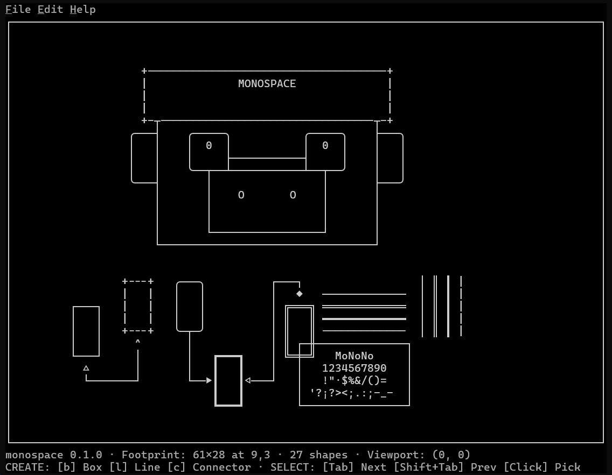
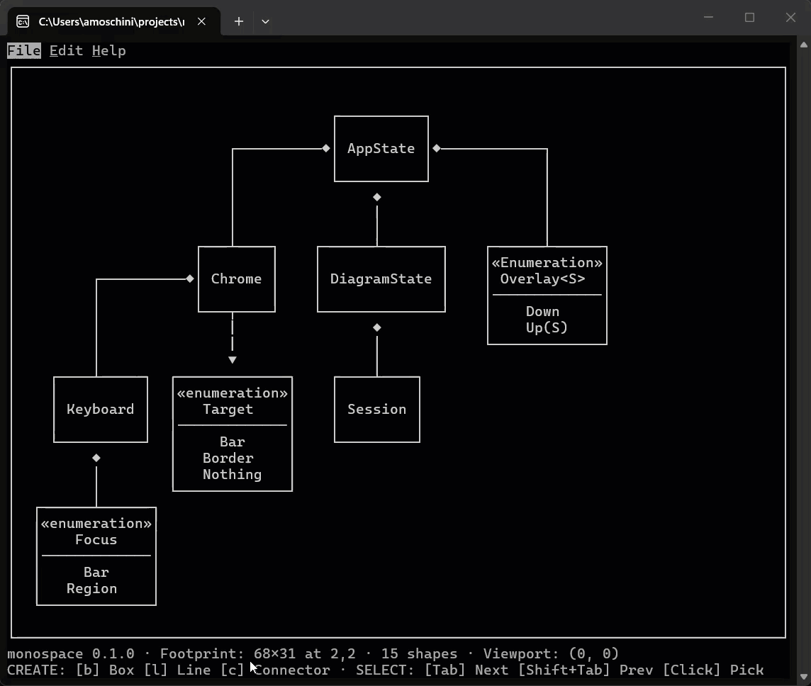
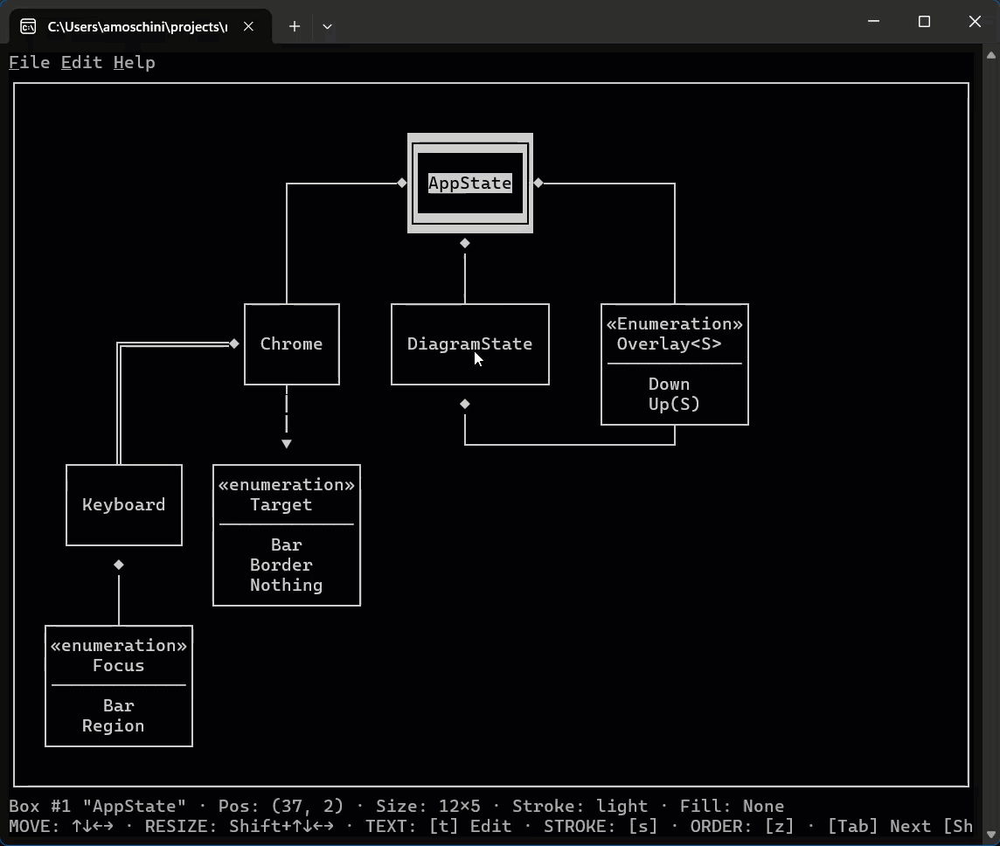

# Monospace

[](https://crates.io/crates/monospace)
[](https://docs.rs/monospace)
[](https://github.com/andresmoschini/monospace/actions/workflows/ci.yml)
[](LICENSE)
[](https://github.com/sponsors/andresmoschini)

> ASCII diagramming, built one honest commit at a time.

**Monospace** is a set of applications and libraries for creating diagrams using ASCII characters —
think boxes, connectors, flowcharts, and architecture sketches, all rendered in plain monospaced
text.

🌐 **Project page:** <https://andresmoschini.github.io/monospace/> — features, gallery and
downloads.



## What is Monospace?

Diagrams belong where engineers read and write: next to the code, in commit messages and in design
discussions. Monospace draws them in plain text, with monospaced ASCII and Unicode box-drawing
characters, so a diagram diffs cleanly with `git diff`, sits inside a Markdown fence, pastes into a
pull request and reads in a terminal without a special viewer.

- **Shapes that compose.** Crossing lines become junctions, adjacent boxes share their borders, and
  the front-most fill covers what is behind it.
- **Connectors that route themselves.** They find an orthogonal path between two shapes and follow
  along as the shapes move.
- **Edit in the terminal.** Select, type labels in place, resize boxes and lines, and drive
  everything from a menu bar with the mouse or the keyboard.
- **Undo without fear.** Every change is a reversible step.





More pictures are in the [gallery](https://andresmoschini.github.io/monospace/#gallery), and
pre-built binaries on the [project page](https://andresmoschini.github.io/monospace/).

## Install

The application is the [`monospace`](https://crates.io/crates/monospace) crate on crates.io:

```sh
cargo install monospace
```

The libraries it is built from are published beside it, under the same version:
[`monospace-core`](https://crates.io/crates/monospace-core),
[`monospace-diagram`](https://crates.io/crates/monospace-diagram),
[`monospace-editing`](https://crates.io/crates/monospace-editing),
[`monospace-description`](https://crates.io/crates/monospace-description),
[`monospace-glyph-sets`](https://crates.io/crates/monospace-glyph-sets), and the non-interactive
renderer [`monospace-cli`](https://crates.io/crates/monospace-cli).

## Why this project exists

This isn't primarily about shipping a diagramming tool. It's a deliberate exercise in learning how
to work effectively with **Spec-Driven Development**, and in practicing solid **Rust architecture,
design, and idioms** along the way. The diagrams are the vehicle; the process is the point.

The idea, part of the domain logic, the design and the model come from a private project of the same
author that will not be published — see [the model](docs/model.md) for the full note. The Rust
architecture, the implementation and the reasoning behind each decision are this repository's own,
even where some carry over an approach already worked out in that project.

## How we're building it

- **Methodology:** Spec-Driven Development — one issue, one branch, one pull request, and a spec
  when there is a decision to agree before the code.
- **Language:** Rust.
- **Cadence:** small, incremental commits. Each one aims to leave the project in a working,
  demonstrable state — no long-lived broken branches, no giant reveals.

The process, the commands and what each check owns are in [CONTRIBUTING.md](CONTRIBUTING.md);
[docs/workflow.md](docs/workflow.md) is the same thing written long, for when the question needs
more than a table.

## Roadmap

Core library, then a minimal CLI, then an interactive TUI, then WebAssembly, then the web app — each
stage on a working foundation from the one before it. The phases and the capabilities the work is
heading towards live on the [GitHub Project](https://github.com/users/andresmoschini/projects/2).

**Why the CLI comes before the TUI.** The CLI is the smallest consumer that can prove the domain
works end to end: it has no editing surface, no state and no event loop, so what it exercises is the
drawing and nothing else. A TUI is a far larger consumer, and building it first means debugging
rendering and input handling in the same sitting, with the drawing the least trustworthy of the
three. Splitting them means the rendering is trusted before anything has to be interactive, and it
means the core's public API is settled by its first consumer rather than by its most demanding one —
the TUI then adds no domain logic at all. The name `monospace` is reserved for that interactive
binary, which is why this one is `monospace-cli`.

## Current status

🚧 **It draws.** Boxes, optionally filled; lines; and connectors that route themselves between two
endpoints, however far apart those are. Where two shapes meet, their strokes compose into a single
cell rather than one overwriting the other, so a crossing becomes a junction and two boxes share a
corner — and the front-most shape's fill is what covers what is behind it:

<!-- render: 20x7
{
  "next_id": 7,
  "shapes": [
    { "kind": "box", "id": 1, "at": { "x": 0, "y": 0 }, "size": { "width": 4, "height": 3 },
      "stroke": "light", "fill": "░" },
    { "kind": "box", "id": 2, "at": { "x": 3, "y": 1 }, "size": { "width": 4, "height": 3 },
      "stroke": "double", "fill": "░" },
    { "kind": "line", "id": 3, "at": { "x": 0, "y": 5 }, "len": 9, "orientation": "horizontal",
      "stroke": "light" },
    { "kind": "line", "id": 4, "at": { "x": 5, "y": 3 }, "len": 4, "orientation": "vertical",
      "stroke": "light" },
    { "kind": "connector", "id": 5, "from": { "at": { "kind": "point", "x": 7, "y": 1 }, "leaving": "right",
        "terminal": { "kind": "glyph", "glyph": "◄" } },
      "to": { "at": { "kind": "point", "x": 16, "y": 4 }, "leaving": "left",
        "terminal": { "kind": "arm" } },
      "stroke": "light" },
    { "kind": "box", "id": 6, "at": { "x": 16, "y": 3 }, "size": { "width": 4, "height": 3 },
      "stroke": "heavy", "fill": "▓" } ] }
-->

```text
┌──┐
│░░╠══╗◄───┐
└──╢░░║    │
   ╚═╤╝    │    ┏━━┓
     │     └────┨▓▓┃
─────┼───       ┗━━┛
     │
```

<!-- /render -->

A diagram is an ordered set of shapes, each carrying the identity the order is addressed by, and it
draws front to back into a window the caller gives it — which is what makes moving one shape forward
change the picture. Nine glyph tables are in reach: the core's own Light and eight more held beside
it, so the same box draws in ASCII, Double, Heavy and their combinations without a second code path.

Behind that, and all of it enforced rather than merely intended:

- **136** tests in `monospace-core`, **610** across the workspace.
- **1856** renderings across 8 snapshots, pinning every arrangement of the connector's route — a
  range too wide to assert by hand, so a change to it is **reported** rather than reviewed: how many
  cases moved, in which families, and three examples with before and after.
- A **thirteen**-step quality gate the pre-commit hook and CI run identically, including the check
  that keeps the portable crates compiling for WebAssembly, so stage 4 stays reachable instead of
  becoming a rewrite.

Still missing, and named here rather than implied: the editing **surface** — the interactive
application's frame, its menu, its way out, the diagram it was given, selecting one of its shapes
with a click, deleting the selected shape, moving it with the arrow keys, giving that change back,
the keyboard moving between the bar and the diagram, `Alt` or `F10` reaching a menu, the About
dialog, and a view that the wheel and the bars move are here, and editing one beyond that is not —
and persistence. The view moves with the wheel and with the bars on the region's border; no key
moves it yet, which is [#237](https://github.com/andresmoschini/monospace/issues/237)'s, and what
the status bar says about where it stands is
[#226](https://github.com/andresmoschini/monospace/issues/226)'s.

## Getting started

```sh
rustup toolchain install   # reads rust-toolchain.toml
cargo xtask setup          # installs the Node tooling the gate needs

cargo run -p monospace-cli                      # a demonstration: eight pictures, then the walk back
cargo run -p monospace-cli -- path/to.json      # one picture, for the description you give it
cargo run -p monospace-cli -- --symbols         # the sheet: one row per style, one cell per symbol
cargo run -p monospace                          # the interactive application: the frame, the menu, the diagram and the way out
cargo run -p monospace -- path/to.json          # the same screen, drawing the description you give it
cargo xtask check                               # the whole quality gate
```

A description is JSON: an ordinal and a list of shapes, documented by the crate that owns it,
`crates/monospace-description`. `monospace-cli` holds no domain logic of its own — it reads a
description and draws the `Diagram` it gets back.

**The window is the caller's**, and this binary names it with two flags: `--size <width>x<height>`
and, beside it, `--origin <x>,<y>`. A path given neither is drawn into `50x17` at `(0, 0)`, which is
the demonstration's own window — a convenience for a person running the binary by hand rather than a
rule any file depends on. **The sheet takes neither**, because it draws no description: `--symbols`
prints every style the catalog holds and the seven symbols each draws, which is
[`docs/symbols.md`](docs/symbols.md).

### Layout

| Path                           | What it is                                                                               |
| ------------------------------ | ---------------------------------------------------------------------------------------- |
| `crates/monospace-core`        | The library. All domain logic lives here, and nothing else.                              |
| `crates/monospace-diagram`     | The model: a diagram as an ordered set of shapes, drawable.                              |
| `crates/monospace-editing`     | A diagram being edited, and the steps behind and ahead of it.                            |
| `crates/monospace-glyph-sets`  | The glyph tables the core does not ship as built-in data.                                |
| `crates/monospace-description` | The JSON file format, read into a `Diagram`.                                             |
| `crates/monospace-cli`         | The command-line application. Holds no logic of its own.                                 |
| `crates/monospace`             | The interactive application: the frame, the menu, the diagram and the way out.           |
| `xtask/`                       | Repository automation. `cargo xtask check` is the gate.                                  |
| `site/`                        | The static landing page published to GitHub Pages. See [site/README.md](site/README.md). |
| `docs/model.md`                | The domain's design, its provenance, and its open questions.                             |
| `docs/diagram-model.md`        | The diagram model's rules: shapes, order, positions.                                     |
| `docs/editing-model.md`        | The editing layer above it: commands, steps, giving back.                                |
| `docs/application-model.md`    | The layer above that one: the frame, the state, the actions.                             |
| `docs/glyph-sets.md`           | The glyph tables and how they degrade.                                                   |
| `docs/symbols.md`              | The seven symbols, the styles that draw them, and the sheet.                             |
| `docs/tui-conventions.md`      | A survey of terminal interface conventions. Decides nothing.                             |
| `docs/memory-cost.md`          | What a diagram and a session cost, measured. Decides nothing.                            |
| `docs/workflow.md`             | Why the process works the way it does, written at length.                                |
| `specs/`                       | One spec per change that had a decision to agree first.                                  |

## Guiding principles

Process over product, demonstrable increments, and claims that are measured rather than assumed. The
rules are in [CONTRIBUTING.md](CONTRIBUTING.md) and [`AGENTS.md`](AGENTS.md) — which is where they
are enforced from, not merely listed. Where the reasoning behind a decision lives — the module's
rustdoc, the model documents, or the pull request body where it was taken — is
[the section on it](CONTRIBUTING.md#where-the-reasoning-lives).

## Sponsoring

Monospace is built in the open, one honest commit at a time, and it stays free under the MIT
License. If it saves you time — or you want to support the specs, the tests and the drawings that go
into it — you can sponsor the work through
[GitHub Sponsors](https://github.com/sponsors/andresmoschini).

Sponsoring is optional and buys no priority, no private access and no say in the roadmap: issues and
pull requests are the contribution path, and they stay open to everyone.

## License

This project is licensed under the MIT License - see the [LICENSE](LICENSE) file for details.

The MIT License is a permissive open source license that allows you to use, copy, modify, and
distribute the code freely, with only the requirement to include the original copyright notice.

---

_This project is a learning journey as much as a piece of software. Expect the specs, the code, and
this README to evolve together._
