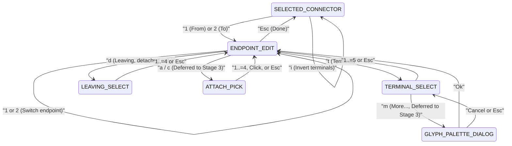

# Connector and terminal editing direction

**Status:** Direction, not specification. This document records the non-binding North Star for
interactive connector and terminal editing on the 2-line contextual bar. Where implementation
reveals a simpler or better interaction, we may deviate from this path; binding decisions live in
`specs/NNN-slug.md`, domain semantics live in [`diagram-model.md`](diagram-model.md) and
[`editing-model.md`](editing-model.md), and general contextual bar principles and the overall
3-stage roadmap live in [`contextual-ui.md`](contextual-ui.md).

**Created:** 2026-11-08, synthesized from the connector editing design drafts and aligned with the
merged Slice 1 specification ([#320](../specs/320-invert-connector-terminals-with-an-i-key.md)).

---

## 1. Domain foundation and endpoint anatomy

### 1.1 Why connectors have no Resize command

In Monospace, geometric shapes such as `Box` and `Line` possess explicit dimensional parameters: a
box defines width and height, while a line defines an explicit coordinate span. Resizing a box
adjusts its bounding rectangle, and resizing a line lengthens or shortens its run along its axis.

A connector (`Shape::Connector`), by contrast, has no independent size, width, or height fields. Its
geometry and orthogonal path routing derive entirely from its two endpoints (`from` and `to`), their
leaving directions, and the canvas obstacles standing between them (see
[`diagram-model.md`](diagram-model.md) §6 and [`model.md`](model.md)). The routing algorithm
computes the optimal orthogonal route—minimizing bends and path length while keeping runs
centered—on the fly. Because a connector's geometry is fully determined by its endpoints, a general
`RESIZE` action is meaningless: editing a connector's geometry means editing its endpoints.

### 1.2 Properties of a ConnectorEndpoint

Every connector endpoint (`Endpoint`) pairs an attachment position (`at`) with a terminal style
(`terminal`):

| Property   | Domain Type                                 | Description                                                                                                                                                                                                                                                                        |
| :--------- | :------------------------------------------ | :--------------------------------------------------------------------------------------------------------------------------------------------------------------------------------------------------------------------------------------------------------------------------------- |
| `at`       | `EndpointAt` (`Reference` or `Absolute`)    | Attachment placement. Either a `Reference` attached to a shape's anchor face with tangential `offset` and orthogonal standoff `out`, or an `Absolute` detached point at canvas coordinates `Pos(x, y)`.                                                                            |
| `leaving`  | `Direction` (`Up`, `Right`, `Down`, `Left`) | Departure direction of the connector line from the endpoint. For attached endpoints, derived directly from the anchor face normal (`Top` leaves `Up`, `Right` leaves `Right`, `Bottom` leaves `Down`, `Left` leaves `Left`). For detached endpoints, explicitly set by the author. |
| `out`      | `usize` / `i16`                             | Orthogonal standoff distance in cells, pushing away from the face along the face normal before admitting the first bend in routing.                                                                                                                                                |
| `terminal` | `Terminal` (`Arm`, `Symbol`, `Glyph`)       | The visual head or termination style drawn at the endpoint cell: unadorned line continuation (`Terminal::Arm`), catalog symbol (`Terminal::Symbol`), or literal single-cell character (`Terminal::Glyph`).                                                                         |

> [!NOTE] **Attached non-arm terminals default to standing 1 cell outward.** As established in
> [#317](../specs/317-attached-non-arm-connector-terminals-sta.md), while an `Arm` terminal joins
> and composes into the border cell (`effective_out = reference.out + 0`) forming box-drawing
> junctions (`├`, `┤`, `┬`, `┴`), a non-arm terminal (`Symbol` or `Glyph`) does not compose.
> Instead, non-arm terminals resolve with an automatic `+1` outward cell offset along the anchor
> normal (`effective_out = reference.out + 1`), terminating cleanly against the shape border without
> overwriting it. An explicit `out` is additive to this base offset.

### 1.3 Offset vs. out: two distinct spatial controls

On an attached endpoint, `offset` and `out` control orthogonal axes relative to the target shape's
anchor face:

- **Tangential `offset: Delta (dx, dy)`:** Slides the attachment point along the shape's face
  perimeter (tangential displacement), clamped to the span of that face.
- **Orthogonal `out: i16`:** Pushes the attachment point and its initial bend outward away from the
  face (normal displacement), providing clearance and breathing room.

Although on simple straight runs (such as a connector leaving a right face horizontally) increasing
`offset.dx` and increasing `out` might appear to produce similar drawings by lengthening the first
segment, they are conceptually completely distinct:

```text
Default: offset = (0, 0), out = 0        Increased out: out = 2
┌────────┐          ┌────────┐          ┌────────┐          ┌────────┐
│ Client ├─────────▶│ Server │          │ Client ├───────▶  │ Server │
└────────┘          └────────┘          └────────┘          └────────┘

Tangential offset: offset.dy = +1       Both offset.dy = +1 and out = 2
┌────────┐          ┌────────┐          ┌────────┐          ┌────────┐
│        │          │        │          │        │          │        │
│ Client ├────┐     │ Server │          │ Client ├───┐      │ Server │
│        │    └────▶│        │          │        │   └───▶  │        │
└────────┘          └────────┘          └────────┘          └────────┘
```

In diagram authoring, `out` is among the most frequently tuned parameters because it prevents
routing elbows and arrowheads from crowding against adjacent shape borders.

### 1.4 Terminal styles and the 1-cell glyph constraint

Monospace supports three terminal families at the domain layer:

| Family         | Domain Representation        | Visual Manifestation                                                                                                                                                                          |
| :------------- | :--------------------------- | :-------------------------------------------------------------------------------------------------------------------------------------------------------------------------------------------- |
| `None` / `Arm` | `Terminal::Arm`              | Unadorned line continuation that composes into the border cell to form junctions (`├`, `┬`, `─`). Represented in the UI as `arm ─`.                                                           |
| `Symbol`       | `Terminal::Symbol { style }` | Directional catalog arrowheads oriented against `leaving`: `solid` (`▶`, `▲`, `▼`, `◀`), `outline` (`▷`, `△`, `▽`, `◁`), `arrow` (`→`, `↑`, `↓`, `←`), or `ascii` (`>`, `^`, `v`, `<`).       |
| `Glyph`        | `Terminal::Glyph { glyph }`  | An arbitrary literal character (e.g. `◆`, `●`, `○`, `■`, `*`), drawn fixed at the terminal position without rotation. In the terminal palette, diamond `◆` is represented as a literal glyph. |

**The 1-cell glyph constraint:** Grid alignment is a foundational invariant of Monospace. Terminal
cells occupy exactly 1 column × 1 row. Characters with a display width of 2 cells (such as East
Asian full-width characters, CJK ideographs, or emoji) are strictly excluded from terminal glyph
selection. Permitting wide characters would break column alignments, displace box borders, and
corrupt diagram layout.

---

## 2. State machine and 2-line bar design

The contextual editing workflow operates across five primary states, with two deferred states
reserved for Stage 3:



> [!NOTE] **Attached and Detached are model states, not UI modes.** In the application
> implementation, `Attached` and `Detached` are not distinct UI modes; they are direct reflections
> of the domain model. The UI sub-mode tracks only which endpoint is being edited
> (`SubMode::Endpoint(End::From)` or `SubMode::Endpoint(End::To)`). The contextual command table
> dynamically conditions its blocks on whether that active endpoint's position is a
> `Position::Reference` or a `Position::Absolute`. When an author attaches or detaches an endpoint,
> the next frame reads the domain model and updates the bar automatically.
>
> Likewise, discrete sub-modes like `SubMode::TerminalSelect(End)` store their parent endpoint,
> allowing `Esc` to return directly to `SubMode::Endpoint(End)` in a flat
> `sub_mode: Option<SubMode>` without requiring a modal navigation stack.

### 2.1 SELECTED_CONNECTOR

When a connector is selected, the 2-line contextual bar inspects the connector's stroke and both
endpoints in Row 0, and offers connector-level actions in Row 1. Whole-connector `MOVE` is retired
(connectors are shaped exclusively through their endpoints):

```text
Connector #4 · Stroke: light · 1. From: Attached to Box #1 at right, offset (0, 0), out 0 arm ─ · 2. To: Attached to Box #2 at left, offset (0, 0), out 0 solid ▶
ENDPOINTS: [1] From [2] To · INVERT: [i] · STROKE: [s] · ORDER: [z] · [Del] Delete · [Esc] Deselect
```

When an endpoint is detached, Row 0 formats its absolute coordinates and leaving direction:

```text
Connector #7 · Stroke: heavy · 1. From: Attached to Box #3 at bottom, offset (0, 0), out 0 arm │ · 2. To: Detached at (40, 12), leaving North arrow ↓
ENDPOINTS: [1] From [2] To · INVERT: [i] · STROKE: [s] · ORDER: [z] · [Del] Delete · [Esc] Deselect
```

| Key                 | Action / Command                                          | History Step                            |
| :------------------ | :-------------------------------------------------------- | :-------------------------------------- |
| `1` / `2`           | Enter `ENDPOINT_EDIT` for endpoint 1 (`From`) or 2 (`To`) | None (mode transition)                  |
| `i`                 | Invert terminals (`Command::InvertTerminals`, #320)       | One step (silent if identical per #285) |
| `s`                 | Open stroke selector (`STROKE_SELECT`)                    | None (selector sub-mode)                |
| `z`                 | Open ordering mode (`ORDER_MODE`)                         | None (selector sub-mode)                |
| `Tab` / `Shift+Tab` | Cycle selection to next / previous shape (#307)           | None                                    |
| `Del`               | Delete connector (`Command::Remove`)                      | One step                                |
| `Esc`               | Deselect connector (return to `IDLE`)                     | None                                    |

### 2.2 ENDPOINT_EDIT (Attached endpoint)

Entered by pressing `1` or `2` when a connector is selected. This is a continuous sub-mode where
keystrokes directly mutate endpoint properties:

```text
ENDPOINT 2. To of Connector #4 · Attached to Box #2 at left, offset (0, 0), out 0 · Term: solid ▶
OFFSET: ↑↓←→ · OUT: [+] [-] · [0] Detach · TERMINAL: [t] · [1] From · [Esc] Done
```

When `offset != (0, 0)` or `out != 0`, `[r] Reset` appears after `OUT: [+] [-]`:

```text
ENDPOINT 2. To of Connector #4 · Attached to Box #2 at left, offset (0, 1), out 0 · Term: solid ▶
OFFSET: ↑↓←→ · OUT: [+] [-] · [r] Reset · [0] Detach · TERMINAL: [t] · [1] From · [Esc] Done
```

| Key       | Action / Command                                                          | History Step                                                  |
| :-------- | :------------------------------------------------------------------------ | :------------------------------------------------------------ |
| `↑↓←→`    | Adjust `offset` (`dx`, `dy`) relative to the anchor point                 | One step per press                                            |
| `+` / `-` | Increment / decrement orthogonal standoff `out`                           | One step per press (negative values permitted)                |
| `r`       | Reset `offset` to `(0, 0)` and `out` to `0`                               | One step (offered only when `offset != (0, 0)` or `out != 0`) |
| `t`       | Open discrete `TERMINAL_SELECT`                                           | None (sub-mode)                                               |
| `1` / `2` | Switch active endpoint to 1 (`From`) or 2 (`To`) without leaving sub-mode | None                                                          |
| `Esc`     | Exit endpoint editing and return to `SELECTED_CONNECTOR` (`Done`)         | None                                                          |
| `0`       | Detach endpoint to `Absolute` at current coordinates                      | One step                                                      |
| `c`       | Change target shape via `ATTACH_PICK` (_Deferred to Stage 3_)             | None (sub-mode)                                               |

### 2.3 ENDPOINT_EDIT (Detached endpoint)

When the active endpoint is detached (`Position::Absolute`), Row 0 displays its canvas coordinates
and leaving direction, and the bar adapts its commands (omitting `OUT` and `Reset`):

```text
ENDPOINT 2. To of Connector #4 · Detached at (40, 12), leaving North · Term: arrow ↓
MOVE: ↑↓←→ · LEAVING: [d] · TERMINAL: [t] · [1] From · [Esc] Done
```

| Key       | Action / Command                                                   | History Step       |
| :-------- | :----------------------------------------------------------------- | :----------------- |
| `↑↓←→`    | Move absolute coordinates `Pos(x, y)` across the canvas            | One step per press |
| `t`       | Open discrete `TERMINAL_SELECT`                                    | None (sub-mode)    |
| `1` / `2` | Switch active endpoint to 1 (`From`) or 2 (`To`)                   | None               |
| `Esc`     | Return to `SELECTED_CONNECTOR` (`Done`)                            | None               |
| `d`       | Open discrete `LEAVING_SELECT`                                     | None (sub-mode)    |
| `a`       | Attach endpoint to shape via `ATTACH_PICK` (_Deferred to Stage 3_) | None (sub-mode)    |

### 2.4 TERMINAL_SELECT

Entered by pressing `t` from `ENDPOINT_EDIT`. This is a discrete sub-mode presenting terminal
options directly on Row 1:

```text
TERMINAL for 2. To of Connector #4 · Current: solid ▼
TERMINAL: [1] arm ─ [2] solid ▶ [3] outline ▷ [4] ascii > [5] diamond ◆ · [Esc] Cancel
```

| Key   | Action / Command                                                           | History Step                         |
| :---- | :------------------------------------------------------------------------- | :----------------------------------- |
| `1`   | Set `Terminal::Arm` (plain unadorned termination)                          | One step, returns to `ENDPOINT_EDIT` |
| `2`   | Set `Terminal::Symbol { style: "solid" }` (`▶`)                            | One step, returns to `ENDPOINT_EDIT` |
| `3`   | Set `Terminal::Symbol { style: "outline" }` (`▷`)                          | One step, returns to `ENDPOINT_EDIT` |
| `4`   | Set `Terminal::Symbol { style: "ascii" }` (`>`)                            | One step, returns to `ENDPOINT_EDIT` |
| `5`   | Set `Terminal::Glyph { glyph: "◆" }` (`◆`)                                 | One step, returns to `ENDPOINT_EDIT` |
| `m`   | Open extended glyph palette `GLYPH_PALETTE_DIALOG` (_Deferred to Stage 3_) | None (modal dialog)                  |
| `Esc` | Cancel selection and return directly to `ENDPOINT_EDIT`                    | None                                 |

> [!NOTE] Fixed directional symbols (`▶`, `▷`, `>`), arm (`─`), and diamond (`◆`) on Row 1 act as
> stable menu cues regardless of the connector's current angle. On the canvas and in Row 0,
> directional symbols orient dynamically against the endpoint's actual `leaving` direction.

### 2.5 LEAVING_SELECT

Entered by pressing `d` on a detached endpoint in `ENDPOINT_EDIT`. This is a discrete sub-mode
allowing explicit selection of the departure direction:

```text
LEAVING for 2. To of Connector #4 · Detached at (40, 12) · Current: North
LEAVING: [1] ↑ North [2] → East [3] ↓ South [4] ← West · [Esc] Cancel
```

| Key   | Action / Command                              | History Step                         |
| :---- | :-------------------------------------------- | :----------------------------------- |
| `1`   | Set `leaving: Direction::Up` (North)          | One step, returns to `ENDPOINT_EDIT` |
| `2`   | Set `leaving: Direction::Right` (East)        | One step, returns to `ENDPOINT_EDIT` |
| `3`   | Set `leaving: Direction::Down` (South)        | One step, returns to `ENDPOINT_EDIT` |
| `4`   | Set `leaving: Direction::Left` (West)         | One step, returns to `ENDPOINT_EDIT` |
| `Esc` | Cancel and return directly to `ENDPOINT_EDIT` | None                                 |

The digit keys follow the clockwise compass sequence (`1` Up, `2` Right, `3` Down, `4` Left),
matching the anchor numbering of shape sides (`Top`, `Right`, `Bottom`, `Left`) to preserve spatial
muscle memory.

### 2.6 Deferred states: ATTACH_PICK and GLYPH_PALETTE_DIALOG

To close the usability gaps identified in early designs, two additional mechanisms were conceived:

- **`ATTACH_PICK` (H1 & H2):** Allows keyboard-driven shape attachment and reassignment without
  requiring a mouse or detached intermediate steps. Pressing `a` (on a detached endpoint) or `c`
  (change shape on an attached endpoint) initiates `ATTACH_PICK`:

  ```text
  ATTACH 2. To of Connector #4 · Target: Box #2 "Server" (1 of 4) [Left]
  TARGET: [Tab] Next [Shift+Tab] Prev · ANCHOR: [1] Top [2] Right [3] Bottom [4] Left · [Esc] Cancel
  ```

  `Tab` and `Shift+Tab` cycle candidate target shapes ordered by proximity to the endpoint. Digits
  `1..=4` snap the endpoint to the corresponding face of the target shape (with `offset = (0, 0)`
  and `out = 0`) and return to `ENDPOINT_EDIT`. Alternatively, a mouse click directly on a target
  shape attaches the endpoint to the nearest face.

- **`GLYPH_PALETTE_DIALOG` (H5 & H7):** Envisioned for authoring custom single-cell Unicode terminal
  glyphs (`[m] More...` from `TERMINAL_SELECT`). Confining selections strictly to 1-column
  characters prevents grid disruption. Confirming a glyph with `Ok` applies `Terminal::Glyph` and
  returns directly to `ENDPOINT_EDIT`.

**Deferred to Stage 3:** Both mechanisms require substantial subsystem infrastructure: `ATTACH_PICK`
requires candidate spatial sorting, target boundary highlighting, and hit-testing routines;
`GLYPH_PALETTE_DIALOG` requires modal dialog overlay integration. In alignment with the 3-stage
roadmap in [`contextual-ui.md`](contextual-ui.md), these states are explicitly **deferred to Stage
3** so that the complete inline keyboard editing workflow (Slices 2–8) can ship cleanly and
immediately in Stage 1.

---

## 3. Cross-cutting design choices

### 3.1 Inline bar selector (1..=5) for common terminals

Common terminal heads (`arm ─`, `solid ▶`, `outline ▷`, `ascii >`, `diamond ◆`) account for the vast
majority of diagram authoring needs. Rather than interrupting the user's flow with a heavy modal
popup dialog, terminal selection is resolved entirely within Row 1 of the contextual bar. A single
keystroke selects the style, commits a reversible command, and returns focus immediately to
`ENDPOINT_EDIT`. Extended Unicode glyph palettes are reserved strictly for advanced customization.

### 3.2 Retiring whole-connector MOVE

In early iterations, connectors inherited the generic `MOVE: ↑↓←→` action from `SELECTION`. However,
moving a connector as a whole is conceptually contradictory when its endpoints are attached to other
figures: displacing the connector would either silently break attachments or produce invalid
geometries.

Once Slices 2 and 3 introduce individual endpoint movement (`[1]` From and `[2]` To),
whole-connector displacement becomes redundant and confusing. Slice 4 permanently removes
`MOVE: ↑↓←→` from `SELECTED_CONNECTOR`.

### 3.3 Continuous ENDPOINT_EDIT with direct switching

Editing an endpoint is designed as a continuous sub-mode. Authors can make multiple successive
nudges (adjusting `offset`, tweaking `out`, changing terminals) where each individual keypress
constitutes a clean history step in `Session`.

Crucially, sub-selectors like `TERMINAL_SELECT` and `LEAVING_SELECT` return directly to
`ENDPOINT_EDIT` upon selection or cancellation, rather than popping all the way back to
`SELECTED_CONNECTOR`. Furthermore, authors can toggle between endpoints by pressing `1` (From) or
`2` (To) directly within `ENDPOINT_EDIT`, enabling rapid end-to-end adjustments without repeated
mode re-entries. Pressing `Esc` completes the session (`Done`) and returns to `SELECTED_CONNECTOR`.

### 3.4 Explicit leaving control for detached endpoints

When an endpoint is attached to a shape's face (`Position::Reference`), its departure direction is
automatically derived from that face's outward normal: `Right` leaves `Right`, `Top` leaves `Up`.
The user does not configure `leaving` on attached endpoints.

When an endpoint is detached (`Position::Absolute`), it has no parent face to derive departure from.
Because the departure direction dictates how the routing engine initiates the first path segment and
which way arrowheads face, detached endpoints require explicit control via `LEAVING_SELECT` (`[d]`).

### 3.5 Composable domain commands

All endpoint mutations map to explicit, pure commands in `monospace_editing` (e.g. `SetEnd`,
`InvertTerminals`). Boundary conditions adhere strictly to the silence rule of
[#285](../specs/285-a-command-that-changes-nothing-records-n.md):

- Decrementing `out` with `-` when `out == 0` is a silent no-op.
- Nudging `offset` beyond the clamped dimensions of a shape's face produces no displacement.
- Inverting identical terminals produces an unchanged shape.

In all such boundary cases, `Command::apply_to` returns `None`, the diagram remains untouched, and
no spurious history step is added to the undo stack.

---

## 4. User walkthroughs

### 4.1 Fine-tuning offset and out on an attached endpoint

An author wants to adjust the arrival point of a connector on `Server` to lower it by one row and
give the arrowhead breathing room:

```text
Initial state:
┌────────┐          ┌────────┐
│ Client ├─────────▶│ Server │
└────────┘          └────────┘
```

1. Author selects Connector #4. The contextual bar shows:

   ```text
   Connector #4 · Stroke: light · 1. From: Attached to Box #1 at right, offset (0, 0), out 0 arm ─ · 2. To: Attached to Box #2 at left, offset (0, 0), out 0 solid ▶
   ENDPOINTS: [1] From [2] To · INVERT: [i] · STROKE: [s] · ORDER: [z] · [Del] Delete · [Esc] Deselect
   ```

2. Author presses `2` to edit the `To` endpoint:

   ```text
   ENDPOINT 2. To of Connector #4 · Attached to Box #2 at left, offset (0, 0), out 0 · Term: solid ▶
   OFFSET: ↑↓←→ · OUT: [+] [-] · [0] Detach · TERMINAL: [t] · [1] From · [Esc] Done
   ```

3. Author presses `↓`. The attachment point moves down one row (`offset.dy = 1`):

   ```text
   ENDPOINT 2. To of Connector #4 · Attached to Box #2 at left, offset (0, 1), out 0 · Term: solid ▶
   OFFSET: ↑↓←→ · OUT: [+] [-] · [r] Reset · [0] Detach · TERMINAL: [t] · [1] From · [Esc] Done
   ```

4. Author presses `+` twice. The standoff distance increases to `out: 2`:

   ```text
   ENDPOINT 2. To of Connector #4 · Attached to Box #2 at left, offset (0, 1), out 2 · Term: solid ▶
   OFFSET: ↑↓←→ · OUT: [+] [-] · [r] Reset · [0] Detach · TERMINAL: [t] · [1] From · [Esc] Done
   ```

   The diagram updates in real time:

   ```text
   ┌────────┐          ┌────────┐
   │ Client ├───┐      │ Server │
   └────────┘   └───▶  │        │
                       └────────┘
   ```

5. Author presses `Esc` (`Done`). The bar returns to `SELECTED_CONNECTOR`. Each keystroke (`↓`, `+`,
   `+`) recorded one step in `Session`; pressing `Undo` three times reverts the adjustments step by
   step.

### 4.2 Detaching an endpoint, moving it freely, and changing leaving direction

An author wants to detach the arrow end from `Server` and leave it open in canvas space pointing
downward:

1. In `ENDPOINT_EDIT` for endpoint 2, author presses `0` (`Detach`). The endpoint freezes into an
   `Absolute` point at its current resolved coordinates:

   ```text
   ENDPOINT 2. To of Connector #4 · Detached at (20, 5), leaving West · Term: solid ◀
   MOVE: ↑↓←→ · LEAVING: [d] · TERMINAL: [t] · [1] From · [Esc] Done
   ```

2. Author presses `↓` three times to move the open point lower on the canvas.
3. Author presses `d` to change the leaving direction. The bar enters `LEAVING_SELECT`:

   ```text
   LEAVING for 2. To of Connector #4 · Detached at (20, 8) · Current: West
   LEAVING: [1] ↑ North [2] → East [3] ↓ South [4] ← West · [Esc] Cancel
   ```

4. Author presses `1` (`↑ North`). The leaving direction becomes `Up`, causing the terminal
   arrowhead to point downward (`↓`). The bar immediately returns to `ENDPOINT_EDIT`:

   ```text
   ENDPOINT 2. To of Connector #4 · Detached at (20, 8), leaving North · Term: solid ↓
   MOVE: ↑↓←→ · LEAVING: [d] · TERMINAL: [t] · [1] From · [Esc] Done
   ```

### 4.3 Changing endpoint terminals and swapping them with i

An author wants to turn a one-way request arrow into a two-way flow, then reverse the primary
direction:

1. Author selects Connector #4 and presses `1` to edit `From`.
2. Author presses `t` to open `TERMINAL_SELECT`:

   ```text
   TERMINAL for 1. From of Connector #4 · Current: arm ─
   TERMINAL: [1] arm ─ [2] solid ▶ [3] outline ▷ [4] ascii > [5] diamond ◆ · [Esc] Cancel
   ```

3. Author presses `2` (`solid ▶`). The `From` endpoint receives a solid arrowhead facing against its
   leaving direction (`◀`), and the bar returns to `ENDPOINT_EDIT`:

   ```text
   ENDPOINT 1. From of Connector #4 · Attached to Box #1 at right, offset (0, 0), out 0 · Term: solid ◀
   OFFSET: ↑↓←→ · OUT: [+] [-] · TERMINAL: [t] · [2] To · [Esc] Done
   ```

   Canvas now shows a bidirectional connector:

   ```text
   ┌────────┐          ┌────────┐
   │ Client │◀────────▶│ Server │
   └────────┘          └────────┘
   ```

4. Author presses `Esc` to return to `SELECTED_CONNECTOR`.
5. Author presses `i` (`Invert`). `from.terminal` and `to.terminal` swap in a single atomic command
   step, while preserving all coordinates and anchor offsets identically.

### 4.4 Connecting or reconnecting an endpoint to a shape (Deferred to Stage 3)

An author wants to reconnect a detached endpoint to a new box (`Cache`) using the keyboard:

1. In `ENDPOINT_EDIT` for the detached endpoint, author presses `a` (`Attach`).
2. `ATTACH_PICK` opens, highlighting the nearest candidate box on the canvas:

   ```text
   ATTACH 2. To of Connector #4 · Target: Box #3 "Server" (1 of 3) [Left]
   TARGET: [Tab] Next [Shift+Tab] Prev · ANCHOR: [1] Top [2] Right [3] Bottom [4] Left · [Esc] Cancel
   ```

3. Author presses `Tab` to cycle target focus to `Box #5 "Cache"`:

   ```text
   ATTACH 2. To of Connector #4 · Target: Box #5 "Cache" (2 of 3) [Left]
   TARGET: [Tab] Next [Shift+Tab] Prev · ANCHOR: [1] Top [2] Right [3] Bottom [4] Left · [Esc] Cancel
   ```

4. Author presses `4` (`Left`). The endpoint snaps to the left anchor face of `Cache` with
   `offset = (0, 0)` and `out = 0`, and the bar returns directly to `ENDPOINT_EDIT`.

---

## 5. Atomic slices and staging

The connector editing roadmap is organized into atomic, incrementally deliverable slices aligned
with [`contextual-ui.md`](contextual-ui.md):

### 5.1 Completed

- **Slice 1 — Invert terminals (`[i]`) and inspect terminals in Row 0:** Implemented in
  [#320](../specs/320-invert-connector-terminals-with-an-i-key.md). Added
  `Command::InvertTerminals`, `INVERT: [i]` action on `SELECTED_CONNECTOR`, and detailed terminal
  inspection (`solid ▶`, `arm ─`) in Row 0.
- **Slice 2 — Endpoint selection and inspection (`[1]` / `[2]`):** Implemented in
  [#325](../specs/325-select-and-inspect-connector-endpoints-w.md). Introduces `ENDPOINT_EDIT`
  continuous sub-mode. Pressing `1` or `2` enters the mode, Row 0 inspects the active endpoint's
  anchor/coordinates and terminal, `[1]` / `[2]` toggle between endpoints, and `[Esc] Done` returns
  to `SELECTED_CONNECTOR`.
- **Slice 3 — Move endpoint with cursor arrows:** Implemented in
  [#328](../specs/328-move-connector-endpoints-with-arrows-adj.md). In `ENDPOINT_EDIT`, arrow keys
  `↑↓←→` adjust tangential `offset` on attached endpoints (clamped to the face span) or canvas
  coordinates `Pos(x, y)` on detached endpoints.
- **Slice 4 — Retire general connector MOVE:** Implemented in
  [#328](../specs/328-move-connector-endpoints-with-arrows-adj.md). Removes `MOVE: ↑↓←→` from
  `SELECTED_CONNECTOR`. With individual endpoint movement active, whole-connector displacement is
  retired to eliminate contradictory attachment semantics.
- **Slice 5 — Adjust orthogonal standoff `out` with `+` / `-`:** Implemented in
  [#328](../specs/328-move-connector-endpoints-with-arrows-adj.md). In `ENDPOINT_EDIT`, `+`
  increments and `-` decrements `out` on the active endpoint. Decrementing at `out == 0` is a silent
  no-op (#285).
- **Slice 6 — Reset `offset` and `out` with `[r]`:** Implemented in
  [#328](../specs/328-move-connector-endpoints-with-arrows-adj.md). Displays `[r] Reset` in
  `ENDPOINT_EDIT` whenever `offset != (0, 0)` or `out != 0`. Pressing `r` resets both parameters to
  `0` in a single command step.
- **Slice 7 — Detach endpoint (`[0]`) and select leaving direction (`[d]`):** Implemented in
  [#334](../specs/334-detach-connector-endpoints-with-0-and-se.md). Added
  `Shape::with_endpoint_detached`, `Shape::with_endpoint_leaving`, `Command::DetachEndpoint`,
  `Command::SetEndpointLeaving`, `[0] Detach` in `ENDPOINT_EDIT`, and `SubMode::LeavingSelect`
  (`LEAVING: [d]`).
- **Slice 8 — Inline terminal selector (`[t]`):** Implemented in
  [#331](../specs/331-select-connector-endpoint-terminal-style.md). Pressing `t` in `ENDPOINT_EDIT`
  opens `TERMINAL_SELECT` (`SubMode::TerminalSelect(End)`) on Row 1, offering `1..=5` (`arm ─`,
  `solid ▶`, `outline ▷`, `ascii >`, `diamond ◆`). Selecting an option dispatches
  `Command::SetEndpointTerminal` and returns directly to `ENDPOINT_EDIT`.

### 5.2 Stage 1: Easy connector functions

All Stage 1 easy connector functions (Slices 1–8) are completed.

### 5.3 Stage 3: Deferred capabilities

- **Slice 9 — Keyboard `ATTACH_PICK` (`[a]` / `[c]`, `Tab`, `1..=4`):** Keyboard-driven target
  cycling and face selection for attaching detached endpoints or changing parent shapes.
- **Slice 10 — Mouse click in `ATTACH_PICK`:** Direct mouse click on a canvas shape to select and
  attach to the nearest face.
- **Slice 11 — Extended glyph palette (`[m]`):** Modal dialog `GLYPH_PALETTE_DIALOG` filtered
  strictly to 1-column characters for custom terminal glyphs.
- **Slice 12 — Final visual refinements:** Refinements such as omitting zero values (`(0, 0)`,
  `out:0`) in Row 0 status strings for cleaner presentation.

---

## 6. Out of scope

The following capabilities are deliberately excluded from this design:

- **Dragging endpoints with the mouse:** Requires interactive drag-and-drop gesture infrastructure
  not present in the current terminal event architecture. Mouse interaction is limited to discrete
  clicks.
- **Manual intermediate waypoints:** The routing engine derives orthogonal routes algorithmically
  from endpoints and obstacles. Manual routing bends or waypoint nodes are not supported.
- **Text labels on connectors:** Connector text annotation requires new domain data structures and
  layout rules, deferred to future domain modeling.
