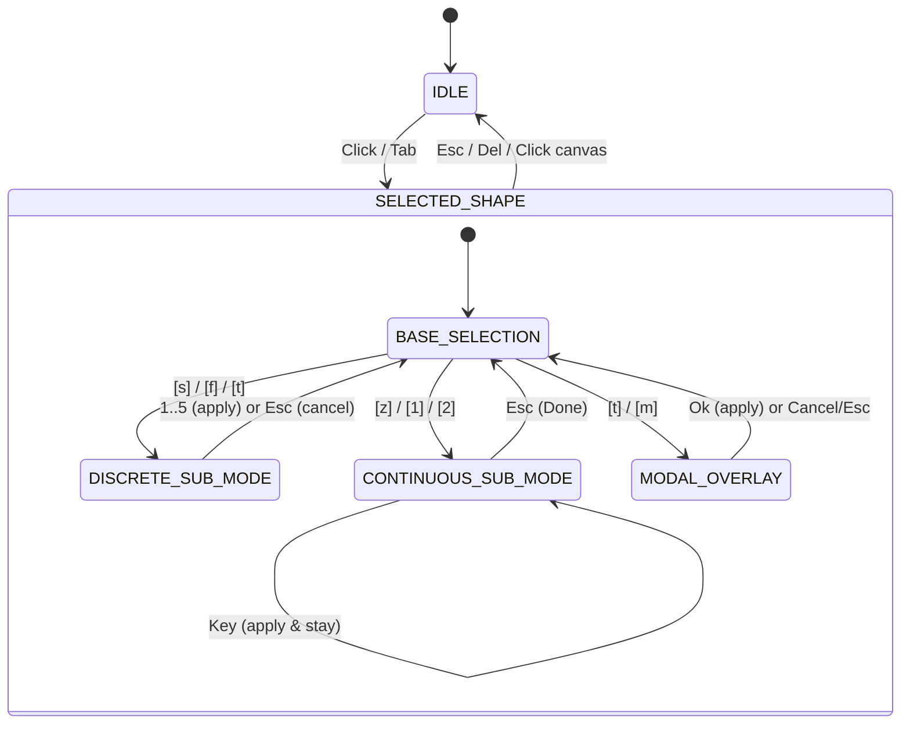

# Contextual interface direction

**Status:** Direction, not specification. This document records the design intent and visual grammar
for the contextual status and command dock and its editing workflows. It is a non-binding **North
Star**: it guides architectural cohesion and incremental consistency across slices without
constraining discovery. Where implementation experience reveals a simpler, faster, or more ergonomic
alternative in the real terminal, the project may deviate from this document without ceremony.
Binding decisions live in accepted specifications (`specs/NNN-slug.md`), and actual implemented
behavior lives in [`application-model.md`](application-model.md). For detailed connector and
terminal editing workflows, see [`connector-editing.md`](connector-editing.md).

---

## 1. Guiding principles

### Non-blocking direction

This document describes the intended interaction model for controlling diagrams from the terminal
interface. It is not an immutable contract or a mandatory checklist. Implementation advances through
small, independent slices. Every slice has complete freedom to experiment, alter shortcuts, or
choose an alternative mechanism when real-world terminal ergonomics demonstrate that another
approach is superior. Reality takes precedence over the map: when practical experience contradicts
this document, this document is amended to reflect what was learned, never the reverse.

### Incremental honesty

The contextual command row displays **only actions and shortcuts that are implemented and operable
right now**. A shortcut never appears in the bar as a decorative preview or non-functional
placeholder. Every new capability adds its block to the bar in the exact same commit and pull
request that makes it functional in the engine.

### Representation rule (`offer == acceptance`)

The lower dock's command row is not an independent menu drawn alongside an event dispatcher; it is
the visual representation of the dispatcher. The diagram region's key handler and the command row
read from a single unified context table (`crates/monospace/src/context_table.rs`).

Every key offered in the bar for the active context is accepted by the dispatcher. Every key not
offered by the active context returns `Reply::Ignored`. Both in base selection states and in
ephemeral sub-modes, unoffered keys return `Reply::Ignored` so that unclaimed global shortcuts
(`Ctrl+Z`, `Ctrl+Shift+Z`, `Ctrl+S`, `Ctrl+Q`, `Ctrl+N`, `Ctrl+O`) fall through cleanly to
`callbacks::route` and the application's global shortcut handler (`shortcuts.rs`) without coupling
the contextual table to global shortcut tables
([#288](https://github.com/andresmoschini/monospace/issues/288),
[#292](https://github.com/andresmoschini/monospace/issues/292)). Keystrokes that neither layer
claims are discarded (`Control::Continue`) without mutating the canvas or cancelling an active
sub-mode. Chrome navigation keys (`F10`, `Alt` plus hotkey) are intercepted by the top menu before
the region is polled. Emergency application termination is assigned to `Ctrl+Shift+Q` with global
reach (`Reach::Always`), freeing `Ctrl+C` for standard clipboard operations in text fields
([#304](https://github.com/andresmoschini/monospace/issues/304)).

### Direct domain command dispatch and silent no-ops

Contextual actions construct domain commands directly as
`Action::Command(monospace_editing::Command)` carrying the selected figure's identity
([#313](https://github.com/andresmoschini/monospace/issues/313)). A command that applies to the
current context but produces no change in the diagram (such as resizing a 2×2 box smaller, or
bringing a figure already at the top further forward) returns `None` and records no history step in
the session ([#285](https://github.com/andresmoschini/monospace/issues/285)).

Following every command execution on the canvas, the diagram state automatically reconciles
selection (`reconcile_selection`): if the selected shape was removed, selection and any active
sub-mode reset to `None` ([#313](https://github.com/andresmoschini/monospace/issues/313)).
Furthermore, when effective undo or redo walks the session history, the figure the step touched
becomes the selection, or nothing is selected when the restored drawing does not hold it
([#299](https://github.com/andresmoschini/monospace/issues/299)), and any active sub-mode ends
either way. If an undo or redo walk has no effect (silence at the boundary of history), the active
selection and sub-mode remain intact.

### Zero free-text input in the bar

The contextual dock responds exclusively to discrete keystrokes, direct digits, and cursor arrows.
Free-text entry (such as multiline box labels) and extended glyph selection occur in dedicated modal
overlays (`DialogFrame` centered over the canvas in the single `overlay: Option<Overlay>` slot,
[#304](https://github.com/andresmoschini/monospace/issues/304),
[#311](https://github.com/andresmoschini/monospace/issues/311)). This keeps the contextual
dispatcher predictable, atomic, and testable.

---

## 2. Screen layout and contextual bar grammar

### Vertical screen zones

The full application screen is divided vertically into four distinct zones:

```text
┌────────────────────────────────────────────────────────────────────────┐
│ 1. Menu Bar (Row 0): File   Insert   Edit   Help                       │
├────────────────────────────────────────────────────────────────────────┤
│                                                                        │
│ 2. Canvas Viewport (Rows 1 to H-3): Interactive diagram area           │
│                                                                        │
├────────────────────────────────────────────────────────────────────────┤
│ 3. Inspector / Status Row (Row H-2): Identity, metrics, and styles     │
├────────────────────────────────────────────────────────────────────────┤
│ 4. Command / Action Row (Row H-1): Operable contextual instructions    │
└────────────────────────────────────────────────────────────────────────┘
```

### Active two-line dock structure

The bottom dock occupies exactly two rows:

- **Row 0 (`Inspector` / Status):** Identifies the active state or selected shape—shape type, `#id`,
  optional user label, coordinates `Pos: (x, y)`, dimensions (`Size: W×H` or `Length: L`), and
  active styling attributes (`Stroke`, `Fill`, layer depth, or connector endpoints).
- **Row 1 (`Actions` / Commands):** Displays the key combinations operable in the current context,
  grouped into functional blocks separated by `·`. It does not duplicate global menu actions
  (`Save`, `Open`, `Undo`, `Redo`, `Quit`), which belong to the top menu bar.

### Block ordering priority

Within selection states, command blocks flow from left to right in order of operational frequency:

1. **Primary spatial and attribute actions:** Direct geometry and content manipulation
   (`MOVE: ↑↓←→`, `RESIZE: Shift+↑↓←→` or `RESIZE: Shift+←→` / `Shift+↑↓`, `TEXT: [t] Edit`,
   `INVERT: [i]`).
2. **Sub-mode and overlay triggers:** Secondary attribute flows (`STROKE: [s]`, `FILL: [f]`,
   `ORDER: [z]`).
3. **Destructive and exit actions:** Selection traversal, duplication, and termination
   (`[Tab] Next [Shift+Tab] Prev`, `[d] Duplicate`, `[Del] Delete`, `[Esc] Deselect` / `Cancel` /
   `Done`).

### Visual notation conventions

- **Key notation:** Discrete operable keys are enclosed in brackets: `[s]`, `[t]`, `[d]`, `[Del]`,
  `[Esc]`. Directional clusters are written without brackets: `↑↓←→`, `Shift+↑↓←→`, `Shift+←→`,
  `Shift+↑↓`.
- **Category labels:** Block categories are uppercase followed by a colon: `MOVE:`, `RESIZE:`,
  `TEXT:`, `STROKE:`, `FILL:`, `ORDER:`.
- **Sub-mode options:** Inline choices list numbered or lettered shortcuts followed by labels:
  `GROUP: [1] opt1 [2] opt2 [3] opt3`.
- **Block delimiter:** `·` (middle dot surrounded by spaces) separates functional blocks. The `│`
  character is reserved for the outer terminal and frame borders so category boundaries are never
  confused with framing.
- **Label truncation:** The only field permitted to elide is an arbitrary user-written text label,
  which truncates with `…` when terminal columns are constrained. Structural attributes
  (coordinates, dimensions, stroke names) and operable commands are never truncated.

### Postponed dynamic multi-line wrapping

The architectural design of the contextual dock follows a **zero-loss principle**: no status
information or available shortcut should ever be silently omitted or clipped due to narrow terminal
widths. Under [#280](https://github.com/andresmoschini/monospace/issues/280), when a dock row
exceeds the available terminal width (such as on 80-column or 60-column terminals), whole
`·`-delimited blocks wrap onto subsequent rows without splitting within a block. Because the canvas
viewport is anchored at top-left `(0, 0)`, a dock that expands from two rows to three or four rows
does not shift drawn diagram coordinates; it merely adjusts how many canvas rows are visible.

However, full multi-line block wrapping is intentionally **postponed**. Until the number of
simultaneously offered contextual actions exceeds standard 80-column widths, the dock remains
strictly fixed at two rows.

---

## 3. Interaction categories

The interface employs three distinct interaction mechanisms:



### 1. Base selection states

The primary resting states of the editor: `IDLE` (no shape selected), `SELECTED_BOX`,
`SELECTED_LINE`, and `SELECTED_CONNECTOR`. Keystrokes directly dispatch immediate domain commands
(`Move`, `Resize`, `Remove`), navigate selection (`Tab` / `Shift+Tab`), or transition into sub-modes
or overlays.

### 2. Inline sub-modes (`SubMode`)

Ephemeral modal states maintained inside `DiagramState` via `sub_mode: Option<SubMode>`. The command
row transforms into an interactive prompt, while the inspector row displays sub-mode context.
Sub-modes follow two behavioral contracts:

- **Discrete sub-modes (`_SELECT`):** Single-keystroke selection. The user presses an option key
  (e.g. `1..=5`), which applies the choice via a domain command and immediately returns to the
  parent selection state. Pressing `[Esc] Cancel` exits without applying changes. _Examples:_
  `STROKE_SELECT` (`[s]`), `FILL_SELECT` (`[f]`), `TERMINAL_SELECT` (`[t]`), `LEAVING_SELECT`
  (`[d]`), `ATTACH_SELECT` (`[a]`).
- **Continuous sub-modes (`_MODE` / `_EDIT`):** Iterative adjustments. Each keystroke immediately
  executes an atomic domain command on the session (recording an undo step if the diagram changed)
  and remains inside the sub-mode for further adjustments. Pressing `[Esc] Done` leaves the sub-mode
  while preserving all cumulative adjustments. _Examples:_ `ORDER_MODE` (`[z]`), `ENDPOINT_EDIT`
  (`[1]` / `[2]`).

### 3. Modal overlays (`Overlay`)

Full modal dialogs rendered over the canvas using `DialogFrame` in the unified
`overlay: Option<Overlay>` slot in `AppState`
([#311](https://github.com/andresmoschini/monospace/issues/311)). While an overlay is active, it
claims all keyboard input: `Tab` and `Shift+Tab` cycle widget focus, `Enter` activates the focused
button or inserts newlines in text areas, and `Esc` closes the overlay. The lower two-line
contextual dock remains visible but frozen with the canvas state from the preceding frame
([#304](https://github.com/andresmoschini/monospace/issues/304)). _Examples:_ `TEXT_EDIT_DIALOG`
(`[t]`), `GLYPH_PALETTE_DIALOG` (`[m]`), alongside application dialogs (`About`, `Open`, `Save`).

---

## 4. Catalog of contextual states

### 4.1 IDLE

No figure is selected. The user is navigating the diagram or inspecting the canvas.

- **Status:** Implemented (`CREATE: [b] Box [l] Line [c] Connector` unconditionally via
  [#308](https://github.com/andresmoschini/monospace/issues/308);
  `SELECT: [Tab] Next [Shift+Tab] Prev [Click] Pick` when diagram has shapes via
  [#307](https://github.com/andresmoschini/monospace/issues/307)).

```text
monospace 0.1.1 · Footprint: 46×17 at 0,0 · 27 shapes · Viewport: (0, 0)
CREATE: [b] Box [l] Line [c] Connector · SELECT: [Tab] Next [Shift+Tab] Prev [Click] Pick
```

_When the diagram is empty (`0 shapes`), `Condition::HasShapes` is false and row 1 offers creation
alone:_

```text
monospace 0.1.1 · Footprint: nothing drawn · 0 shapes · Viewport: (0, 0)
CREATE: [b] Box [l] Line [c] Connector
```

- **Behavior:** Unselected arrow keys return `Reply::Ignored`. On a non-empty diagram, `Tab` selects
  the first figure in drawing order (`Diagram::shapes()`, back-most) and `Shift+Tab` (`BackTab`)
  selects the last (front-most) figure; on an empty diagram both return `Reply::Ignored`. Clicking
  any figure selects it and transitions to the corresponding `SELECTED_*` state.

---

### 4.2 SELECTED_BOX

A `Shape::Box` is selected.

- **Status:** Implemented (`MOVE: ↑↓←→`, `RESIZE: Shift+↑↓←→`, `TEXT: [t] Edit`, `STROKE: [s]`,
  `ORDER: [z]`, `[Tab] Next [Shift+Tab] Prev` via
  [#307](https://github.com/andresmoschini/monospace/issues/307), `[d] Duplicate` via
  [#349](https://github.com/andresmoschini/monospace/issues/349), `[Del] Delete`, `[Esc] Deselect`).
  Planned: `FILL: [f]` and `[a] Auto-fit`.

```text
Box #2 "API Gateway" · Pos: (14, 6) · Size: 18×5 · Stroke: light
MOVE: ↑↓←→ · RESIZE: Shift+↑↓←→ · TEXT: [t] Edit · STROKE: [s] · ORDER: [z] · [Tab] Next [Shift+Tab] Prev · [d] Duplicate · [Del] Delete · [Esc] Deselect
```

_Planned target with fill selection and auto-fit:_

```text
Box #2 "API Gateway" · Pos: (14, 6) · Size: 18×5 · Stroke: light · Fill: None
MOVE: ↑↓←→ · RESIZE: Shift+↑↓←→ · TEXT: [t] Edit [a] Auto-fit · STROKE: [s] · FILL: [f] · ORDER: [z] · [Tab] Next [Shift+Tab] Prev · [d] Duplicate · [Del] Delete · [Esc] Deselect
```

- **Behavior:**
  - `↑↓←→`: Moves box position `(x, y)` by 1 cell via `Command::Move`.
  - `Shift+↑↓←→`: Resizes width and height (`Command::Resize`). Minimum size is 2×2. Resizing below
    minimum returns `None` and records no history step
    ([#285](https://github.com/andresmoschini/monospace/issues/285)).
  - `t`: Opens multiline text editor modal (`TEXT_EDIT_DIALOG`,
    [#304](https://github.com/andresmoschini/monospace/issues/304)).
  - `a`: Auto-fits box dimensions to text content. Offered **only** when the box contains text
    (`text: Some(_)`). Calculates visual columns (wide glyphs count as 2 columns) and line count
    with padding (width = $\text{max\_cols} + 4$, minimum 4; height = $\text{lines} + 4$, minimum
    5).
  - `s`: Opens `STROKE_SELECT`.
  - `f`: Opens `FILL_SELECT`.
  - `z`: Opens `ORDER_MODE`.
  - `d`: Duplicates the selected box in place (`Shape::clone`), adding it via `Session::add` at the
    front of the drawing order and selecting the new duplicate.
  - `Delete`: Removes box (`Command::Remove`). Connectors attached to it freeze their endpoints at
    their current resolved coordinates.
  - `Esc`: Clears selection and returns to `IDLE`.

---

### 4.3 SELECTED_LINE

A `Shape::Line` is selected.

- **Status:** Implemented (`MOVE: ↑↓←→`, orientation-aware `RESIZE`, `ROTATE: [r]`, `STROKE: [s]`,
  `ORDER: [z]`, `[Tab] Next [Shift+Tab] Prev` via
  [#307](https://github.com/andresmoschini/monospace/issues/307), `[d] Duplicate` via
  [#349](https://github.com/andresmoschini/monospace/issues/349), `[Del] Delete`, `[Esc] Deselect`).

_Horizontal line mockup:_

```text
Line #3 · Pos: (20, 10) · Length: 12 · Orientation: Horizontal · Stroke: light
MOVE: ↑↓←→ · RESIZE: Shift+←→ · ROTATE: [r] · STROKE: [s] · ORDER: [z] · [Tab] Next [Shift+Tab] Prev · [d] Duplicate · [Del] Delete · [Esc] Deselect
```

_Vertical line mockup:_

```text
Line #3 · Pos: (20, 10) · Length: 8 · Orientation: Vertical · Stroke: light
MOVE: ↑↓←→ · RESIZE: Shift+↑↓ · ROTATE: [r] · STROKE: [s] · ORDER: [z] · [Tab] Next [Shift+Tab] Prev · [d] Duplicate · [Del] Delete · [Esc] Deselect
```

- **Behavior:**
  - `RESIZE` is orientation-gated ([#301](https://github.com/andresmoschini/monospace/issues/301)):
    horizontal lines offer and accept only `Shift+←→` (`len += 1` or `len -= 1`, minimum 1);
    vertical lines offer and accept only `Shift+↑↓`. Shifted arrows on the orthogonal axis are
    ignored (`Control::Continue`) without generating a command or history step.
  - `r`: Toggles line orientation between `Horizontal` and `Vertical`, pivoting around `Pos`,
    updating the status row and the `RESIZE` key hint immediately, and recording 1 step.
  - `s`: Opens `STROKE_SELECT`.
  - `z`: Opens `ORDER_MODE`.
  - `d`: Duplicates the selected line in place (`Shape::clone`), adding it via `Session::add` at the
    front of the drawing order and selecting the new duplicate.
  - `Delete`: Removes line and returns to `IDLE`.
  - `Esc`: Deselects and returns to `IDLE`.

---

### 4.4 STROKE_SELECT

A discrete sub-mode triggered by pressing `s` on any selected figure (`Box`, `Line`, or
`Connector`).

- **Status:** Implemented ([#292](https://github.com/andresmoschini/monospace/issues/292) / PR
  #298).

```text
STROKE SELECTION for Box #2 · Current: light
STROKE: [1] light ┌─┐ [2] double ╔═╗ [3] light-round ╭─╮ [4] heavy ┏━┓ [5] ascii +-+ · [Esc] Cancel
```

- **Behavior:**
  - `1..=5`: Applies the chosen stroke style via `Command::SetStroke` and immediately returns to the
    parent selection state. If the selected figure already uses that stroke, the command produces
    `None` and records no history step
    ([#285](https://github.com/andresmoschini/monospace/issues/285)).
  - `Esc`: Cancels and returns to the parent selection state without changing the stroke.
  - All unoffered keys return `Reply::Ignored` in the region. Unclaimed global shortcuts (`Ctrl+Z`,
    `Ctrl+S`, `Ctrl+Q`) fall through to the global handler; other keys are discarded with
    `Control::Continue`.

---

### 4.5 FILL_SELECT

A discrete sub-mode triggered by pressing `f` on a selected box.

- **Status:** Planned ([#306](https://github.com/andresmoschini/monospace/issues/306)).

```text
FILL SELECTION for Box #2 · Current: None
FILL: [0] None [1] Space ' ' [2] Light ░ [3] Medium ▒ [4] Dark ▓ · [m] More… · [Esc] Cancel
```

- **Behavior:**
  - `0`: Transparent fill (`None`).
  - `1`: Space fill (`Some(Glyph(' '))`), occluding figures behind it.
  - `2..=4`: Standard unicode shade blocks (`░`, `▒`, `▓`).
  - `m`: Opens the extended modal `GLYPH_PALETTE_DIALOG`.
  - `Esc`: Cancels and returns to `SELECTED_BOX`.

---

### 4.6 ORDER_MODE

A continuous sub-mode triggered by pressing `z` on any selected figure.

- **Status:** Implemented ([#305](https://github.com/andresmoschini/monospace/issues/305) / PR
  #316).

```text
LAYER ORDER for Box #2 · Position: 3 of 6 · Behind: 2, Ahead: 3
ORDER: [Home] Front [End] Back [PgUp] Forward [PgDn] Backward · [Esc] Done
```

- **Behavior:**
  - `PgUp`: Steps figure forward (`Command::Forward`).
  - `PgDn`: Steps figure backward (`Command::Backward`).
  - `Home`: Moves figure to top of draw order (`Command::ToFront`).
  - `End`: Moves figure to bottom of draw order (`Command::ToBack`).
  - Boundary silence ([#285](https://github.com/andresmoschini/monospace/issues/285)): If the figure
    is already at the boundary, the command returns `None` and records no history step.
  - `Esc`: Exits the sub-mode (`Done`), preserving the new layer order and keeping the shape
    selected.

---

### 4.7 TEXT_EDIT_DIALOG

A modal overlay triggered by pressing `t` on a selected box.

- **Status:** Implemented ([#304](https://github.com/andresmoschini/monospace/issues/304) / PR
  #310).

```text
┌─ Text of Box #2 ─────────────────────────────────────────────────────────────┐
│                                                                              │
│  ┌────────────────────────────────────────────────────────────────────────┐  │
│  │ PostgreSQL Primary Database                                            │  │
│  │ Replica: us-east-1                                                     │  │
│  └────────────────────────────────────────────────────────────────────────┘  │
│                                                                              │
│                         [ Ok ]          [ Cancel ]                           │
└──────────────────────────────────────────────────────────────────────────────┘
Box #2 "PostgreSQL Primary Database…" · Pos: (14, 6) · Size: 18×5 · Stroke: light
MOVE: ↑↓←→ · RESIZE: Shift+↑↓←→ · TEXT: [t] Edit · STROKE: [s] · ORDER: [z] · [Del] Delete · [Esc] Deselect
```

- **Behavior:**
  - Renders inside a standard `DialogFrame` hosting the framework's `TextArea` component.
  - `Tab` / `Shift+Tab`: Cycles focus between `TextArea`, `[ Ok ]`, and `[ Cancel ]`.
  - `Enter`: Inserts a newline if `TextArea` has focus, or activates the focused button.
  - `Ok`: Normalizes text (CRLF to `\n`, tabs to 4 spaces, empty whitespace to `None`) and applies
    `Command::SetText`. If unchanged, records no history step
    ([#285](https://github.com/andresmoschini/monospace/issues/285)).
  - `Cancel` / `Esc`: Closes dialog and discards edits.
  - Dock row below remains visible but frozen with the previous canvas state.

---

### 4.8 GLYPH_PALETTE_DIALOG

A modal overlay triggered by pressing `m` from `FILL_SELECT` or `g` from `TERMINAL_SELECT`.

- **Status:** Planned.

```text
┌─ Fill Pattern & Glyph Palette ───────────────────────────────────────────────┐
│                                                                              │
│ [Shades & Blocks]                                                            │
│ [ ]  ░  ▒  ▓  █  ▀  ▄  ▌  ▐  ■  □  ▪  ▫  ▲  ▼  ◆  ◇  ●  ○                    │
│                                                                              │
│ [Hatching & Textures]                                                        │
│ /  \  X  +  #  %  *  |  -  =  ~  ≈  ^  v  <  >  ¬  ¤  $  @                   │
│                                                                              │
│ [Dotted & Stipple]                                                           │
│ ·  :  ∴  ∷  ˙  ¨  …  •  ◦  ‣  ⁃  '  "  `  ,  ;  .  !  ?                      │
│                                                                              │
│ ──────────────────────────────────────────────────────────────────────────── │
│ Selected: [ ▒ ] Medium Shade        Custom Glyph: [ _ ]                      │
│                                                                              │
│                         [ Ok ]          [ Cancel ]                           │
└──────────────────────────────────────────────────────────────────────────────┘
```

- **Behavior:**
  - Arrow keys navigate grid cells; mouse click picks directly.
  - `Tab` focuses the custom glyph input to type or paste any single-column grapheme cluster.
  - When opened for connector terminals, wide glyphs (CJK, emoji) are disallowed to preserve grid
    alignment.
  - `Ok`: Applies selected glyph and returns to the calling state.
  - `Cancel` / `Esc`: Discards selection.

---

### 4.9 Connector states summary

Connectors lack intrinsic scalar width or height (`Shape::Connector { from, to, stroke }`). A
connector is dimensioned entirely by the positions and anchors of its two endpoints. Therefore,
`Command::Resize` never applies to connectors, and `SELECTED_CONNECTOR` never offers `RESIZE`.

The complete endpoint interaction model is specified in detail in
[`connector-editing.md`](connector-editing.md). The table below summarizes the connector state
catalog:

| State                | Type                | Trigger                                                        | Key commands & transitions                                                                                                                     | Description                                                                            |
| :------------------- | :------------------ | :------------------------------------------------------------- | :--------------------------------------------------------------------------------------------------------------------------------------------- | :------------------------------------------------------------------------------------- |
| `SELECTED_CONNECTOR` | Base selection      | Click connector or `Tab`                                       | `[1]` / `[2]` endpoint edit, `[i]` invert terminals, `[s]` stroke, `[z]` order, `[Tab]`/`[Shift+Tab]` cycle, `[d]` duplicate, `[Del]`, `[Esc]` | Top-level connector inspection. Shows endpoints, stroke, and terminals in row 0.       |
| `ENDPOINT_EDIT`      | Continuous sub-mode | `[1]` (start) or `[2]` (end)                                   | `↑↓←→` offset/position, `+`/`-` out, `[r]` reset, `[0]` detach, `[t]` terminal, `[2]` / `[1]` switch, `[Esc]` Done                             | Fine-grained endpoint adjustment. Operates directly on `from` or `to`.                 |
| `TERMINAL_SELECT`    | Discrete sub-mode   | `[t]` in `ENDPOINT_EDIT`                                       | `[1]` arm ─, `[2]` solid ▶, `[3]` outline ▷, `[4]` ascii >, `[5]` diamond ◆, `[Esc]` Cancel                                                    | Selects head symbol or arm for the active endpoint.                                    |
| `LEAVING_SELECT`     | Discrete sub-mode   | `[d]` in `ENDPOINT_EDIT` (detached)                            | `[1]` ↑ North, `[2]` → East, `[3]` ↓ South, `[4]` ← West, `[Esc]` Cancel                                                                       | Sets explicit departure direction for detached (`Absolute`) endpoints.                 |
| `ATTACH_SELECT`      | Discrete sub-mode   | `[a]` in `ENDPOINT_EDIT` (detached, with `Box`/`Line` present) | `Tab`/`Shift+Tab` cycle target focus, click candidate to focus, `1..=4` pick anchor (`Top`, `Right`, `Bottom`, `Left`), `[Esc]` Cancel         | Attaches a detached endpoint to a shape face; does not re-attach an existing endpoint. |

---

## 5. Three-stage implementation plan

### Implemented foundation

The settled architectural foundations backing the contextual interface are:

- **Dock structure and menu separation:**
  [#279](https://github.com/andresmoschini/monospace/issues/279)
- **Box resize with `Shift+↑↓←→`:** [#284](https://github.com/andresmoschini/monospace/issues/284)
- **Silent no-ops in session history:**
  [#285](https://github.com/andresmoschini/monospace/issues/285)
- **Dispatcher ignores unoffered keys:**
  [#288](https://github.com/andresmoschini/monospace/issues/288)
- **Unified context table and `s` sub-mode:**
  [#292](https://github.com/andresmoschini/monospace/issues/292)
- **Selection cleared on effective undo/redo:**
  [#297](https://github.com/andresmoschini/monospace/issues/297)
- **Selection follows the figure a walk touched:**
  [#299](https://github.com/andresmoschini/monospace/issues/299)
- **Orientation-aware line resize:** [#301](https://github.com/andresmoschini/monospace/issues/301)
- **Multiline box text editing with `[t]`:**
  [#304](https://github.com/andresmoschini/monospace/issues/304)
- **Continuous layer ordering sub-mode `z`:**
  [#305](https://github.com/andresmoschini/monospace/issues/305)
- **Single modal overlay slot in `AppState`:**
  [#311](https://github.com/andresmoschini/monospace/issues/311)
- **Direct `Action::Command` dispatch and selection reconciliation:**
  [#313](https://github.com/andresmoschini/monospace/issues/313)
- **Menu bar chrome and clean keyboard routing:**
  [#317](https://github.com/andresmoschini/monospace/issues/317),
  [#320](https://github.com/andresmoschini/monospace/issues/320)
- **Selection cycling with `Tab` and `Shift+Tab`:**
  [#307](https://github.com/andresmoschini/monospace/issues/307)
- **Direct shape creation from `IDLE` (`b`, `l`, `c`):**
  [#308](https://github.com/andresmoschini/monospace/issues/308)
- **Shape duplication with `[d]`:** [#349](https://github.com/andresmoschini/monospace/issues/349)

---

### Stage 1 — Easy connector functions (Slices 2–8)

Detailed in [`connector-editing.md`](connector-editing.md). Progressively delivers endpoint editing
capabilities without waiting for complex attachment wizards:

- **Slice 2: Select and inspect endpoint (`[1]` / `[2]`):** Enters continuous sub-mode
  `ENDPOINT_EDIT`. The inspector row reports full endpoint state (attached shape, face, offset, out,
  terminal). Exits with `[Esc] Done` or switches between endpoints with `[1]` and `[2]`.
- **Slice 3: Move endpoint with cursor arrows (`↑↓←→`):** Adjusts `offset: Delta { dx, dy }` along
  the attached face for `Reference` endpoints, or moves canvas `Pos(x, y)` for detached `Absolute`
  endpoints.
- **Slice 4: Retire general whole-connector `MOVE`:** Removes `MOVE: ↑↓←→` from
  `SELECTED_CONNECTOR`. Connectors are positioned and shaped exclusively through their endpoints.
- **Slice 5: Adjust orthogonal standoff `out` with `+` / `-`:** Adjusts perpendicular separation
  clearance `out: i16` away from the attached shape face.
- **Slice 6: Reset `offset` and `out` to zero with `[r]`:** Offers `[r] Reset` whenever
  `offset != (0, 0)` or `out != 0`, restoring default alignment.
- **Slice 7: Detach endpoint with `[0]` and change `leaving` direction:** `[0]` unhooks the endpoint
  from its attached shape, converting it to `Position::Absolute` frozen at its current resolved
  canvas position. For detached endpoints, offers `[d]` / `LEAVING_SELECT` (`1..=4`) to configure
  departure direction.
- **Slice 8: Inline terminal selector with `[t]`:** Opens discrete `TERMINAL_SELECT` in row 1
  offering `1..=5` (`[1] arm ─ [2] solid ▶ [3] outline ▷ [4] ascii > [5] diamond ◆ · [Esc] Cancel`).

---

### Stage 2 — Other easy contextual functions

Implements self-contained contextual features that fit directly into the unified context table:

1. **Box fill selector with `[f]` (`FILL_SELECT`,
   [#306](https://github.com/andresmoschini/monospace/issues/306)):** Discrete sub-mode on boxes
   offering digits `0..=4`
   (`[0] none [1] space [2] light ░ [3] medium ▒ [4] heavy ▓ · [Esc] Cancel`). Generates
   `Command::SetFill`.
2. **Selection cycling with `Tab` / `Shift+Tab`
   ([#307](https://github.com/andresmoschini/monospace/issues/307)) [Implemented]:** Cycles forward
   (`Tab`) and backward (`Shift+Tab` / `BackTab`) through diagram shapes. Offered in `IDLE`
   (`CREATE: [b] Box [l] Line [c] Connector` unconditionally, followed by
   `SELECT: [Tab] Next [Shift+Tab] Prev [Click] Pick` when diagram has shapes) and immediately
   before `[d] Duplicate · [Del] Delete · [Esc] Deselect` in all `SELECTED_*` states.
3. **Box auto-fit to text content with `[a]` (`Auto-fit`):** Contextual action on `SELECTED_BOX`
   visible **only** when the box contains text (`text: Some(_)`). Executes a single command
   adjusting box width and height to fit the text lines (accounting for 2-column wide glyphs and
   padding).
4. **Shape duplication with `[d]` ([#349](https://github.com/andresmoschini/monospace/issues/349))
   [Implemented]:** Clones the selected box, line, or connector in place via `Session::add`
   (`Command::Add`), placing it at the front of the drawing order and selecting the new duplicate.
   Offered immediately before `[Del] Delete · [Esc] Deselect` in all `SELECTED_*` states.

---

### Stage 3 — Checkpoint: pause and rethink before complex workflows

Upon completing Stages 1 and 2, implementation pauses to evaluate the resulting ergonomics, keyboard
flow, and terminal behavior before designing or building higher-complexity workflows:

- **Changing connector attachments and connection wizards:** Evaluating re-attaching
  already-attached endpoints (`[c]`) and the two-click interactive connection wizard
  (`CONNECT_WIZARD`).
- **Interactive shape creation on the canvas (`[b]`, `[l]`, `[c]`,
  [#308](https://github.com/andresmoschini/monospace/issues/308)) [Implemented]:** Direct keyboard
  creation of default figures (`b` Box, `l` Line, `c` Connector) at viewport center `C` in `IDLE`.
- **Extended glyph palette modal (`[m]` / `GLYPH_PALETTE_DIALOG`):** Evaluating grid navigation and
  custom Unicode grapheme input for fill patterns and terminal heads.
- **Dynamic multi-line dock wrapping
  ([#280](https://github.com/andresmoschini/monospace/issues/280)):** Evaluating zero-loss wrapping
  across narrow terminal geometries (80 or 60 columns) based on actual accumulated action row
  widths.
- **Terminal modifier and keycode fallbacks:** Measuring and addressing terminals and multiplexers
  (`tmux`) that do not reliably report `Shift+arrows`, `BackTab`, or extended key combinations.
